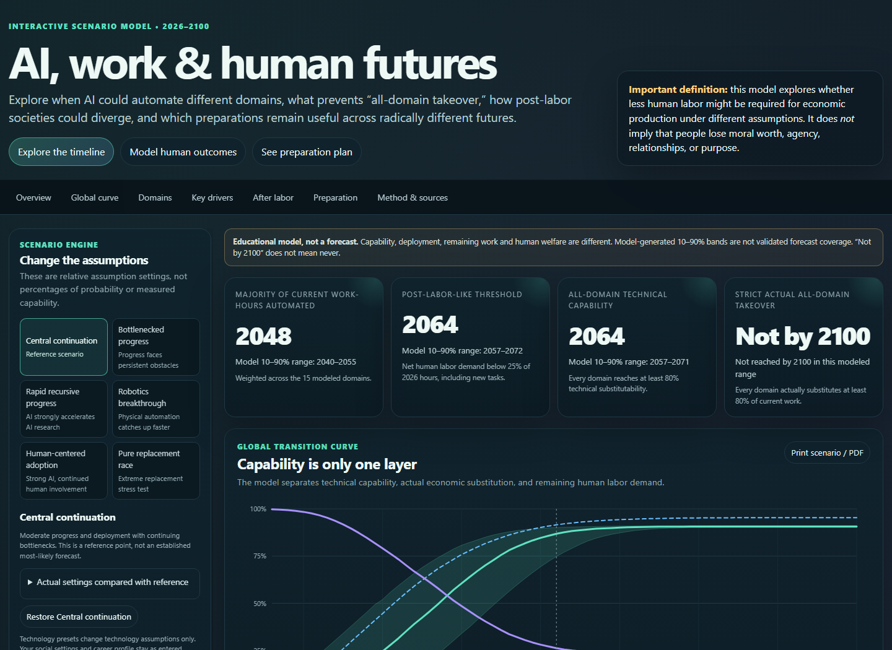
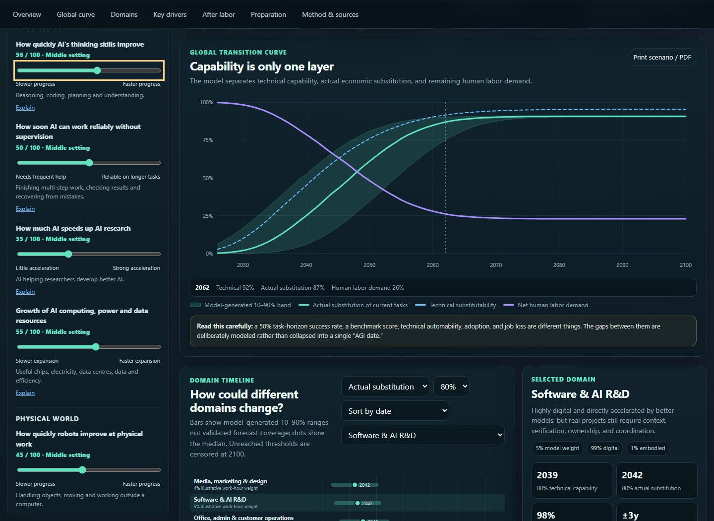
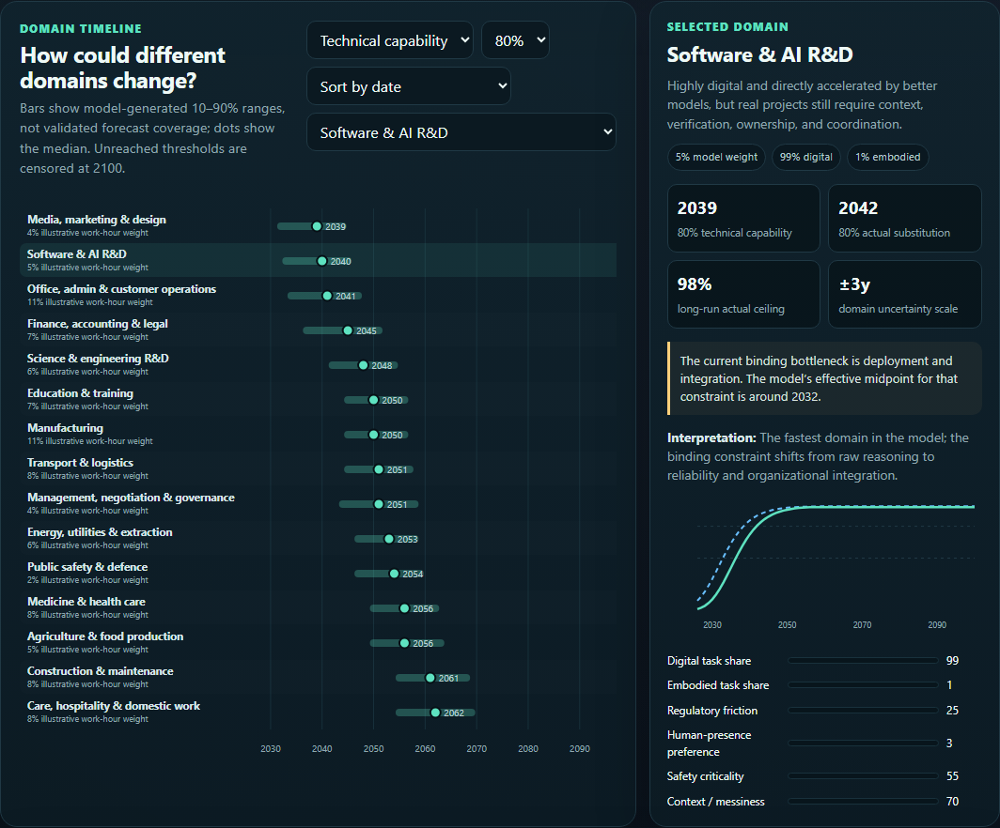
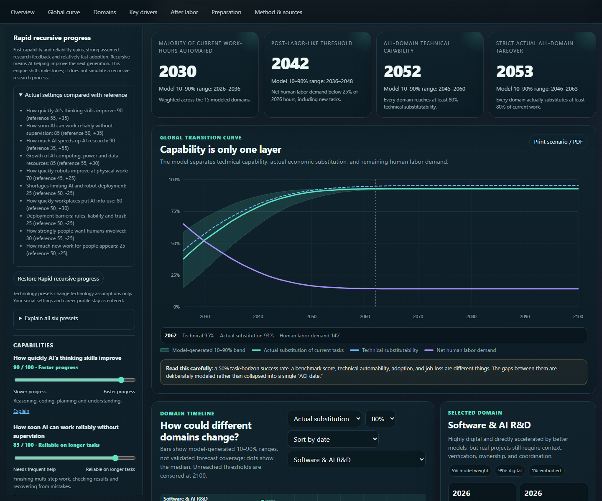
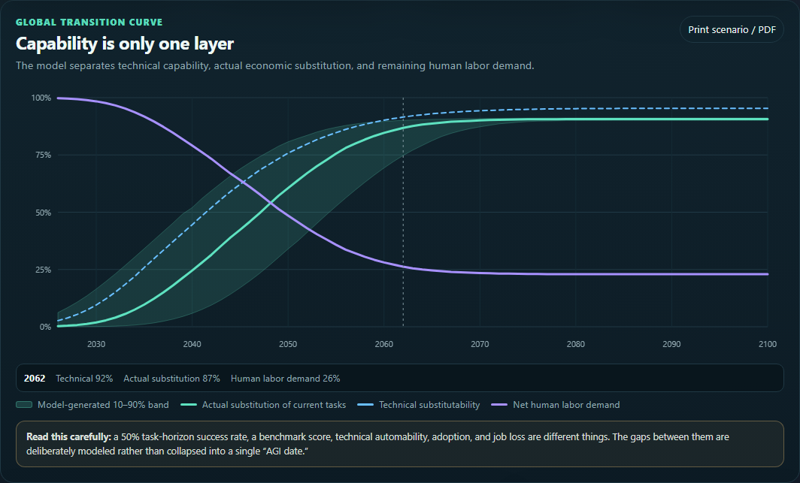
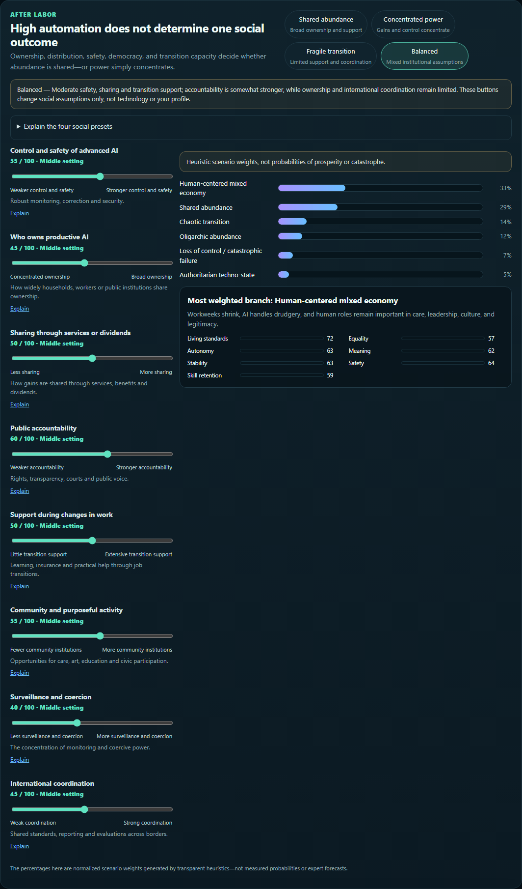

# AI, Work & Human Futures

[Open the simulator](https://nishdel.github.io/ai-work-human-futures/) · [Download the offline HTML](https://nishdel.github.io/ai-work-human-futures/ai-work-human-futures-offline.html)

An illustrative scenario explorer for AI capability, deployment, remaining human work and social outcomes. It preserves a 15-domain, 240-path seeded model and adds an optional career preparation flow. **It is not a validated forecast, unemployment probability or hiring tool.**

## Screenshots

Captured from the running [public simulator](https://nishdel.github.io/ai-work-human-futures/) on 12 October 2026, with the career profile and personal answers left blank. These are genuine browser captures, losslessly optimized as PNGs. Results illustrate assumptions; they are not validated forecasts.

**Main dashboard.** The default Central continuation scenario, preset controls and headline model milestones.



**Interactive sliders.** Capability has been moved from 55 to 56; endpoint meanings, short explanations and Explain links remain visible beside the recalculated curves.



**AI capability charts.** Model-generated ranges for the 80% technical-capability threshold across 15 domains, with software and AI research detail.



**Scenario comparison.** Rapid recursive progress, with its assumption differences from Central continuation expanded and its recalculated results visible.



**Human work projections.** Technical capability, actual task substitution and remaining human work through 2100. Task substitution is not an unemployment probability.



**Human future scenarios.** Balanced social assumptions weight alternative futures and illustrative welfare dimensions. These weights are heuristics, not measured probabilities.



## Run

Open `ai-work-human-futures-offline.html` directly in a browser. It works under `file://` with networking disabled. `index.html` is the identical self-contained static-site build, compatible with a GitHub Pages repository subpath. No installation, login, AI service or backend is needed.

For development, use Node.js 20 or newer:

```sh
npm run build
npm test
npm run serve
```

Preview: `http://127.0.0.1:4178/ai-work-human-futures/`. Build and unit tests use only Node built-ins. Sources are in `src/`; the build inlines them into both HTML files. Do not edit generated HTML directly.

Optional browser checks use an already installed Playwright package and browsers: `npm run test:browser`. Set `QA_BROWSER` to `chromium` or `firefox`; `PLAYWRIGHT_MODULE_PATH`, `BROWSER_EXECUTABLE`, `QA_OUTPUT_DIR` and `PREVIEW_URL` can point to existing installations/output locations. Start the preview server first. Nothing automatically installs browsers or dependencies.

## Use and controls

1. Choose one of six technology presets, then move sliders to explore assumptions. Left/right meanings and a short explanation appear beside every slider; **Explain** opens its fuller on-page entry. Charts recalculate automatically; **Recalculate** retries or refreshes the current assumptions.
2. Compare global curves, domain timelines and the selected domain. Change the timeline metric or threshold to inspect different milestones. Sensitivity changes one assumption at a time.
3. Choose a social preset or adjust the eight social sliders. These change heuristic social weights, not technology curves.
4. Optionally choose a role, review its task mix and answer preparation questions. The public default has no personal profile.
5. Use **Export** / **Import** to save or restore scenario JSON. Exports exclude personal answers unless explicitly included. **Reset** restores technology and social defaults while preserving your entered profile; **Clear my profile** removes answers and notes. Printing omits the profile.

## What is included

- Six technology and four social presets, explained controls and accessible glossary links.
- The original visual identity and global, domain and sensitivity charts.
- Seventeen role archetypes plus custom tasks, 2030/2035/2040 exposure and one alternative-role comparison.
- Separate preparedness and illustrative resilience, visible weights and three answer-dependent preparation actions.
- Strict versioned import/export, including explicit legacy-v2 migration.
- Three verified historical evidence cards with dates, limitations and no automatic model changes.

The interface explains published evidence, author assumptions and visitor answers separately. Read [MODEL.md](MODEL.md), [DATA-LICENSE.md](DATA-LICENSE.md) and [TESTING.md](TESTING.md).

## Privacy

Answers and notes stay in page memory. There are no analytics, accounts, cookies, storage or remote profile processing. Default exports and printed scenario reports omit the entire profile. Explicit profile exports contain personal information. “Clear my profile” clears the session, but cannot remove exported copies. The hosting provider can receive ordinary request metadata; external source links contact their respective sites. See [GitHub Pages documentation](https://docs.github.com/en/pages/getting-started-with-github-pages/what-is-github-pages).

## Evidence updates

The bundled snapshot was reviewed on 11 October 2026; included publications are from 2025 and are labeled historical. Automatic collection is **disabled**. A future workflow could collect and deduplicate primary-source candidates, propose a justified parameter change, run same-seed before/after tests, and require maintainer review before a versioned release. Collection must never overwrite a visitor's scenario. No scheduled collector is shipped.

The existing [MIT license](LICENSE) is preserved. O*NET-derived occupational descriptions remain under CC BY 4.0 with attribution; see [DATA-LICENSE.md](DATA-LICENSE.md).
